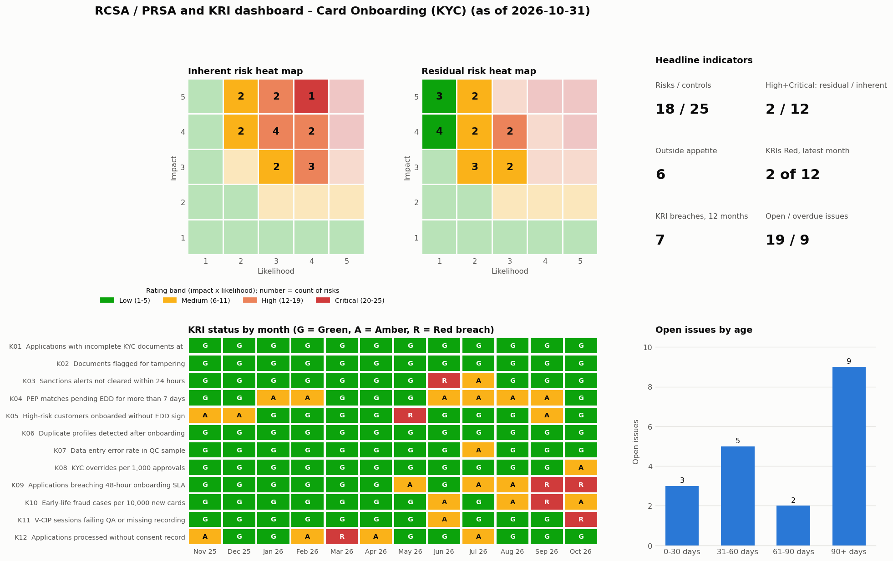

# RCSA / PRSA and KRI Risk Analytics Dashboard – Card Onboarding (KYC)

A process-level **risk and control self-assessment (RCSA / PRSA)** for credit-card onboarding, with
**18 risks and 25 mapped controls** scored for inherent risk, control effectiveness and residual risk. It also
includes a **KRI monitoring dashboard** covering 12 months of data across 12 KRIs, with green/amber/red thresholds,
risk heat maps, breach alerts and issue ageing.

The same scoring logic is implemented three times, and the three agree exactly:
**SQL views** (SQLite), **live Excel formulas**, and a **Python reference**. Power BI reads the SQL output using
the DAX measures in [`powerbi/measures.dax`](powerbi/measures.dax).



---

## 1. Scope

**Process:** Card onboarding (KYC). The sub-processes are application and sourcing, identity and document
verification, screening, customer due diligence, credit decision and limit, account set-up and data, and record keeping.

**Risk categories covered:** fraud, financial crime (AML / sanctions / PEP), regulatory compliance, data management,
information security and privacy, credit, internal fraud and conduct, operational process, and third party (DSA).

| | Count |
|---|---|
| Risks | 18 |
| Controls | 25 (17 preventive, 8 detective; 13 automated, 10 manual, 2 IT-dependent manual) |
| Risk-to-control links | 30 (every risk has at least one control, every control is mapped) |
| KRIs | 12, monthly from Nov 2025 to Oct 2026 |
| Issues | 22, raised from RCSA control weaknesses and Red KRI breaches |

## 2. Scoring methodology

| Step | Rule |
|---|---|
| Inherent risk | Impact (1–5) × Likelihood (1–5) |
| Rating bands | Low 1–5 · Medium 6–11 · High 12–19 · Critical 20–25 |
| Control score | The weaker of the design and operating ratings (Effective = 3, Partially Effective = 2, Ineffective = 1) |
| Control effectiveness for a risk | The average score of its mapped controls (≥ 2.75 Effective, ≥ 1.75 Partially Effective) |
| Likelihood reduction | (avg control score − 1) / 2 × 70% (so fully effective controls cut likelihood by 70%) |
| Residual risk | Impact × max(1, round(Likelihood × (1 − reduction))) |
| Risk appetite | A residual score above 8 is outside appetite |
| KRI RAG | Green if value ≤ green threshold, Amber if ≤ amber threshold, otherwise Red (breach) |
| Issue ageing | Days open as of 31 Oct 2026, bucketed 0–30, 31–60, 61–90 and 90+. An issue is overdue when it is open past its due date |

Controls reduce **likelihood** rather than impact, so the residual position can be drawn on the same 5 × 5 heat map.
The maximum reduction, the appetite level and the as-of date are parameters (`Parameters` sheet / `parameter` table).

## 3. Results (as of 31 Oct 2026)

| Measure | Value |
|---|---|
| Inherent High/Critical risks | 12 of 18 |
| Residual High/Critical risks | 2 of 18 (R02 incomplete KYC documentation, R17 DSA misconduct) |
| Average inherent → residual score | 12.2 → 7.1 |
| Risks outside appetite | 6 (R01, R02, R08, R10, R16, R17) |
| Controls not fully effective | 16 of 25 (2 rated Ineffective on operation: C15 DLP monitoring, C22 DSA quality review) |
| KRI months in Red (12 months) | 7 |
| KRIs Red in latest month | 2 (K09 onboarding SLA breaches, K11 V-CIP QA failures) |
| Open / overdue issues | 19 / 9 (9 aged 90+ days) |

The main finding is that **third-party sourcing (R17)** and **incomplete KYC documentation (R02)** stay High after
controls. For R17, one of its detective controls (C22 mystery shopping) is ineffective. For R02, the maker
checklist and the QC sampling both operate only partially. The **onboarding SLA KRI (K09)** has been Red for two
months running, which links to R16 and to pressure to shortcut checks.

## 4. Deliverables

| Path | What it is |
|---|---|
| [`excel/RCSA_KRI_Workbook.xlsx`](excel/RCSA_KRI_Workbook.xlsx) | The working RCSA file. It has these sheets: **Summary** (KPIs), **Risk_Register** (inherent → residual, all formulas), **Control_Library** (design/operating ratings with drop-down validation), **Risk_Control_Map** (INDEX-MATCH), **Heat_Map** (COUNTIFS 5×5 inherent and residual), **KRI_Library**, **KRI_Data** (RAG formula), **KRI_Dashboard** (SUMIFS month matrix with conditional-format RAG, latest RAG, months in Red/Amber), **Issues** (ageing, overdue flag, bucket), and **Parameters**. Change a rating or a threshold and every score, heat map and KPI updates. |
| [`sql/schema.sql`](sql/schema.sql) | Tables plus the scoring views `v_control_scores`, `v_risk_scores`, `v_kri_rag` and `v_issue_ageing` |
| `data/rcsa.db` | SQLite database built from the schema |
| `data/*.csv` | Catalogue, KRI values and issues (the source data) |
| `data/powerbi/*.csv` | View extracts for Power BI |
| [`powerbi/`](powerbi) | DAX measures (heat map colour, KRI RAG, breach alert, MoM change, issue ageing), theme, and a page-by-page build guide |
| `docs/dashboard_preview.png` | Rendered dashboard: heat maps, headline KPIs, KRI RAG matrix and issue ageing |

## 5. How to run

```bash
pip install -r requirements.txt
python -m rcsa.build      # rebuilds the CSVs, SQLite DB, Excel workbook, Power BI extracts and preview
python -m pytest -q       # scoring, RAG boundaries, ageing, SQL = Python
```

To reassess, edit the impact/likelihood or control ratings in [`rcsa/catalogue.py`](rcsa/catalogue.py) and rebuild.
You can also edit them directly in the Excel workbook. To query the scoring views:

```sql
SELECT risk_id, inherent_score, inherent_rating, avg_control_score, residual_score, residual_rating, appetite_status
FROM v_risk_scores ORDER BY residual_score DESC;
```

## 6. Validation

- The SQL views and an independent Python implementation of the scoring are compared on every build, and the build fails if they differ.
- The Excel workbook was recalculated in Microsoft Excel. All 18 residual scores, the summary KPIs and the KRI statuses matched the SQL output.
- Unit tests cover RAG boundaries, ageing and overdue logic, residual ≤ inherent, and the full-effectiveness reduction.

## 7. Assumptions

- Risks, controls and ratings are an **illustrative self-assessment** written for this project. KRI values and issues
  are **synthetic** (seeded random series with a few planted shocks). No bank data is used.
- KRIs are oriented so that a lower value is always better.
- The Power BI `.pbix` is not committed. Build it in Power BI Desktop from `data/powerbi/` using the guide in [`powerbi/README.md`](powerbi/README.md).
